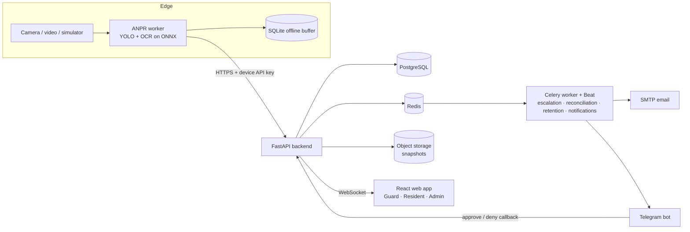

# GateSense: Project Brief and Build Instructions

> **For the AI agent building this repo:** this is your source of truth. Read it fully at the
> start of every session, then read `docs/PROGRESS.md` to see which phase is next.
> Build **one phase per session**, follow the Working Rules exactly, and stop at the end of
> each phase for the owner's review.

---

## 1. What we are building

**GateSense** is an AI-powered society gate and visitor management system.

> *Automatic number-plate entry for residents, resident-approved visitors, and an
> escalation engine that follows up on overstaying vehicles.*

It is the owner's main resume project for internship applications. It must look and feel like a
real product: clean code, a professional UI, a dockerized setup, live deployment, CI/CD, tests,
real measured metrics, and documentation that a recruiter can understand in 60 seconds.

The owner will **monitor** each phase while you build, then **study the codebase phase by
phase** for interviews. Everything must therefore be explainable: simple designs over clever
ones, and every major decision written down.

### Core flow

```
Camera (entry or exit lane)
  → Plate detector (YOLO) → OCR → normalise plate text → fuzzy match
  → Resident vehicle?     → log ENTRY / EXIT automatically
  → Valid guest pass?     → auto-admit, start the visit timer
  → On the watchlist?     → red alert on the guard console
  → Unknown vehicle?      → guard registers the visitor (name, phone, email, flat, purpose)
                          → resident gets Approve / Deny (web + Telegram), 3-minute timeout
                          → on timeout the guard decides
  → Visit timer runs out  → escalation ladder (emails → guard call task)
  → Exit camera reads the plate → visit closed
```

### User roles

| Role | Login | Capabilities |
|---|---|---|
| **Admin** (society secretary) | yes | Manage flats, residents, vehicles, guards, gates/devices, watchlist; analytics; audit log |
| **Guard** | yes | Live gate console, register visitors, correct low-confidence plates, handle escalation call tasks, manual entry/exit |
| **Resident** | yes | Approve/deny visitors, create guest passes, manage own vehicles, see own flat's visit history |
| **Visitor** | no | Gets an email with visit details and an expiring link showing time remaining |
| **Camera device** | API key | Sends gate events to the backend |

---

## 2. Feature scope

### Must-have (v1.0)
1. **Gate events:** devices post plate reads with confidence, snapshot image, lane direction.
2. **Plate normalisation:** Indian plate format check (e.g. `DL01AB1234`, BH series, HSRP),
   common OCR confusion fixes (O/0, I/1, B/8, S/5, Z/2) applied *by position* (letters vs digits),
   plus a fuzzy match against known plates (bounded edit distance).
3. **Debounce / idempotency:** one plate in front of a camera = one event (cooldown window per
   plate per lane; event hash for duplicates).
4. **Entry/exit pairing** and a **visit state machine**:
   `PENDING_APPROVAL → APPROVED → INSIDE → OVERSTAYED → ESCALATED → EXITED`
   (+ `DENIED`, `EXPIRED`). Every transition is validated and logged.
5. **Visit categories with time limits:** guest (4h default), delivery (20 min), cab (10 min),
   service/maintenance (resident-set). Configurable by admin.
6. **Resident approval in real time:** WebSocket push to the web app + Telegram bot inline buttons;
   3-minute timeout falls back to the guard.
7. **Guest passes:** created by residents ahead of time, matched by plate or a one-time code
   (code stored hashed), with a validity window and a usage limit.
8. **Escalation ladder** (scheduled job, runs every minute):
   - at the time limit → email visitor + resident
   - +30 min → reminder email
   - +60 min → "Call resident" task on the guard console; guard marks the outcome
9. **Watchlist:** flagged plates raise a high-priority alert.
10. **Low-confidence handling:** reads below the threshold go to a guard review queue; guard
    corrections are saved as labelled data (`plate_corrections`) for future retraining.
11. **Plate snapshot** stored for every event (local disk / MinIO in dev, S3-compatible in prod).
12. **Analytics:** busiest hours, average visit duration, overstay rate, frequent visitors,
    vehicles currently inside, visitor parking occupancy.
13. **Nightly reconciliation:** finds exits without entries and entries never closed; flags them
    for the admin.
14. **Privacy:** phone numbers masked in UI lists, visitor personal data auto-deleted after
    90 days (configurable), audit log of admin actions.
15. **Demo mode + vehicle simulator:** one-click demo logins per role; a simulator that sends
    realistic events (residents, unknowns, guest passes, overstays) so the live demo always
    looks alive.
16. **Edge offline mode:** the ANPR worker buffers events in SQLite when the backend is
    unreachable and syncs in order when it's back.

### Out of scope for v1 (list under "Future work" in the README)
Multi-society tenancy (keep a `society_id` column so it's possible later), paid SMS/voice-call
APIs, native mobile apps, tailgating detection.

---

## 3. Tech stack

| Layer | Choice | Notes |
|---|---|---|
| Backend API | **Python 3.12, FastAPI**, Pydantic v2 | async, OpenAPI docs at `/docs` |
| DB | **PostgreSQL** + SQLAlchemy 2.0 + **Alembic** migrations | |
| Cache / queue / pub-sub | **Redis** | |
| Background jobs | **Celery** worker + **Celery Beat** | escalation, reconciliation, retention, notifications |
| Real-time | FastAPI **WebSockets** + Redis pub/sub fan-out | |
| ML | **YOLOv8** plate detector, **PaddleOCR or EasyOCR** (pick by measured results), **ONNX Runtime** for inference | train/fine-tune in Google Colab notebooks |
| ANPR worker | separate Python service (camera / video file / image folder / simulator inputs) | |
| Frontend | **React + TypeScript + Vite**, **Tailwind CSS**, **shadcn/ui**, TanStack Query, React Router, Recharts, react-i18next | PWA for the resident app |
| Notifications | SMTP email (**Mailpit** in dev), **Telegram Bot API** | |
| Object storage | local volume / **MinIO** in dev, S3-compatible in prod | |
| Testing | pytest, pytest-asyncio, httpx; Vitest + React Testing Library; **Playwright** e2e; **Locust** load tests | |
| Quality | ruff (lint + format), mypy, ESLint, Prettier, pre-commit | |
| Infra | Docker (multi-stage), Docker Compose, **GitHub Actions** CI/CD, GHCR images | |
| Deploy | decided in Phase 8 after checking the *current* free tiers (e.g. Render / Railway / Fly.io for the API and workers, Vercel for the frontend, Neon / Supabase Postgres, Upstash Redis) | see Phase 8 |

Use current stable versions. Ask the owner before adding a major dependency not listed here.

---

## 4. Architecture



### Repository layout (monorepo)

```
gatesense/
├── CLAUDE.md                 # this file
├── README.md
├── LICENSE                   # MIT
├── docker-compose.yml        # full local stack
├── docker-compose.prod.yml
├── .env.example              # every variable documented, no real secrets
├── .github/
│   ├── workflows/            # ci.yml, deploy.yml
│   ├── ISSUE_TEMPLATE/
│   └── pull_request_template.md
├── backend/
│   ├── app/
│   │   ├── api/              # routers (v1)
│   │   ├── core/             # config, security, logging
│   │   ├── db/               # session, base
│   │   ├── models/           # SQLAlchemy models
│   │   ├── schemas/          # Pydantic schemas
│   │   ├── services/         # business logic (plate matching, visit state machine, …)
│   │   ├── workers/          # Celery tasks
│   │   └── main.py
│   ├── alembic/
│   ├── tests/
│   ├── Dockerfile
│   └── pyproject.toml
├── anpr/
│   ├── gatesense_anpr/       # detector, ocr, normaliser, pipeline, sources, buffer, client
│   ├── notebooks/            # Colab training + evaluation notebooks
│   ├── eval/                 # evaluation scripts → results/*.md / *.json
│   ├── tests/
│   └── Dockerfile
├── simulator/                # demo traffic generator
├── frontend/
│   ├── src/ (app/, features/, components/, lib/, i18n/)
│   ├── tests/ + e2e/
│   └── Dockerfile
├── loadtests/                # Locust
├── scripts/                  # seed, reset-demo, helpers
└── docs/
    ├── PROGRESS.md           # phase tracker (you keep this updated)
    ├── architecture.md
    ├── database.md           # ER diagram (Mermaid) + table explanations
    ├── api.md
    ├── deployment.md
    ├── adr/                  # Architecture Decision Records: 0001-….md
    ├── learn/                # study guides, one per phase (see Working Rules)
    └── assets/               # screenshots, GIFs, diagrams
```

### Data model (starting point; refine in Phase 1 and record the changes in an ADR)

`societies`, `flats`, `users` (role: admin/guard/resident), `residents` (user ↔ flat),
`vehicles` (plate_raw, plate_normalized **unique + indexed**, type car/two-wheeler, owner),
`gates`, `devices` (gate, lane direction ENTRY/EXIT, hashed API key),
`gate_events` (raw read, normalised plate, confidence, snapshot path, device, event_hash
**unique**, match result), `visitors`, `visits` (visitor, flat, plate, category, status,
expected_exit_at, entered_at, exited_at, approved_by), `approvals`, `guest_passes`,
`watchlist`, `plate_corrections`, `notifications`, `escalation_tasks`, `audit_logs`.

---

## 5. UI and design requirements

The UI must look like a polished SaaS product, not a student template.

- **Style:** calm and modern, in the spirit of Linear and Vercel dashboards. Neutral greys plus
  **one** accent colour; Inter (or similar) font; a consistent 4/8-px spacing scale; rounded-xl
  cards; subtle borders instead of heavy shadows. Light and dark themes.
- **Every screen has:** loading skeletons, empty states with a helpful message, error states,
  toast notifications, and confirmation dialogs for destructive actions.
- **Guard console:** dark by default (night shifts), high contrast, large touch targets,
  Hindi + English toggle, at most 2 taps for common actions. Live feed of arrivals with the plate
  snapshot, a pending-approvals column, an alerts/escalation column, and a "vehicles inside" counter.
- **Resident app:** mobile-first PWA. Approve/deny cards, create a guest pass in under
  30 seconds, visit history.
- **Admin dashboard:** analytics charts, management tables with search/filter/pagination,
  watchlist, audit log, settings (time limits, thresholds, retention).
- **Landing page** (`/`): product pitch, feature highlights, architecture image, and big
  "Try demo as Guard / Resident / Admin" buttons.
- **Accessibility:** WCAG AA contrast, keyboard navigable, visible focus rings, labelled inputs.
- Responsive at 375px, 768px and 1280px+. Use real-looking seed data (Indian names, flat numbers
  like `B-402`, valid plate formats), never lorem ipsum.

---

## 6. Phases

Each phase ends with: tests passing, docs updated, `docs/learn/phase-N.md` written,
`docs/PROGRESS.md` updated, a PR opened, and a stop for owner review.

### Phase 0: Repo foundation
- Monorepo skeleton exactly as in §4; MIT licence; `.gitignore`, `.editorconfig`, `.env.example`.
- Pre-commit hooks (ruff, ruff-format, mypy, prettier, eslint, end-of-file, no large files,
  **secret scanning** e.g. gitleaks).
- `docker-compose.yml` with Postgres, Redis, Mailpit, MinIO, plus placeholder backend and frontend
  services that start.
- CI workflow: lint + test jobs for backend and frontend (they may be minimal for now but must pass).
- README skeleton (title, one-liner, badges placeholders, sections to be filled).
- `docs/PROGRESS.md` with all phases listed; ADR-0001 "Monorepo and tech stack".
- PR + issue templates; Conventional Commits explained in `CONTRIBUTING.md`.
- **Done when:** `docker compose up` starts the infra cleanly, CI is green.

### Phase 1: Backend core, database, auth
- FastAPI app with settings (pydantic-settings), structured JSON logging, `/health` and `/ready`.
- SQLAlchemy models + Alembic migration for the data model; `docs/database.md` with a Mermaid ER diagram.
- Auth: JWT access + refresh tokens, bcrypt/argon2 password hashing, **role-based access
  control** via dependencies; device API-key auth (hashed keys).
- CRUD APIs for flats, residents, vehicles, guards, gates, devices, watchlist (admin only),
  with pagination and filtering.
- Seed script with realistic demo data (≈40 flats, ≈60 residents, ≈80 vehicles, 3 guards, 2 gates).
- Tests: unit + API tests against a test Postgres (in CI via a service container); aim for ≥80%
  coverage on `services/`.
- **Done when:** the owner can log in as each role via `/docs` and gets permission errors where expected.

### Phase 2: Gate event engine
- `POST /api/v1/gate-events` (device auth) accepting plate text, confidence, lane, timestamp,
  and a snapshot upload.
- Plate normaliser + validator (Indian formats, position-aware confusion fixes) and fuzzy
  matcher, with a thorough table-driven test suite (≥40 cases including tricky ones).
- Debounce (Redis cooldown) + idempotency (event hash).
- Visit state machine as a pure, well-tested service module; illegal transitions raise errors.
- Resident entry/exit logging, watchlist alerts, low-confidence → review queue.
- Snapshot storage abstraction (local / S3-compatible).
- ADR: "Why a state machine for visits", "Debounce strategy".
- **Done when:** a scripted sequence of events produces correct visits, alerts and review items in tests.

### Phase 3: ANPR ML pipeline
- `anpr` package: detector (YOLOv8) → plate crop → OCR → normaliser → client that posts to the API.
- Input sources: webcam/RTSP, video file, image folder, and `--simulate`.
- **Colab notebooks** for (a) fine-tuning the plate detector and (b) evaluating OCR engines. The
  owner runs these on a Colab GPU; you write them so they run top to bottom without edits.
- **Dataset:** try public Indian number-plate datasets first. If downloads are blocked from your
  environment, stop and give the owner exact download instructions. Also prepare a folder
  structure and labelling guide for the owner's own photos (day/night/rain/angled/HSRP/two-wheelers).
  Large data and model weights **never go in git**: use GitHub Releases or a documented download script.
- Evaluation scripts output tables to `anpr/eval/results/`: detection mAP, OCR character
  accuracy, end-to-end plate accuracy **per condition**, latency/FPS on CPU.
- Model comparison table (e.g. YOLOv8n vs YOLOv8s; PaddleOCR vs EasyOCR) → pick by data; write an ADR.
- Export to **ONNX** (+ try INT8 quantisation) and benchmark before/after on CPU.
- **Done when:** a video file run produces correct gate events in the local stack, and the
  results tables contain real measured numbers (or clearly marked "pending owner Colab run").

### Phase 4: Visitors, approvals, guest passes, real time
- Visitor registration API (guard), visit categories with configurable limits.
- Approval flow: create approval → Redis pub/sub → WebSocket push → resident approves/denies →
  3-minute timeout (Celery) → guard fallback.
- Telegram bot: link a resident account via a one-time code; inline Approve/Deny buttons;
  callbacks verified and idempotent.
- Guest passes: plate- or code-based, hashed codes, validity window, usage limit; auto-admit on match.
- WebSocket channels: guard console feed, per-resident channel; authenticated connections.
- **Done when:** the full unknown-visitor path works end to end in integration tests.

### Phase 5: Escalation, notifications, scheduled jobs
- Celery Beat schedule: overstay checker (every minute), escalation ladder, nightly
  reconciliation, daily retention purge, approval timeouts.
- Email templates (clean HTML + plain text) via SMTP; visible in Mailpit locally.
- Expiring, signed visitor links showing time remaining.
- Escalation tasks for guards with outcome capture (reached / not reached / vehicle left).
- Notification log table; retries with backoff; idempotent tasks.
- **Done when:** with time-mocked tests, an overstaying visit moves through every escalation
  step exactly once.

### Phase 6: Frontend (professional UI)
- Design system first: tokens, theme, shadcn/ui components, layout shells per role.
- Landing page, auth pages, and the Guard / Resident / Admin areas as specified in §5.
- Live updates via WebSocket with reconnect + backoff; optimistic UI where safe.
- i18n (English + Hindi) for the guard console; PWA manifest + service worker for residents.
- Demo mode: role quick-login buttons; a "Reset demo" admin action.
- Component tests (Vitest) and Playwright e2e for the three critical journeys:
  resident vehicle entry, unknown visitor approval, overstay escalation.
- Screenshots of every main screen saved to `docs/assets/`.
- **Done when:** all three journeys pass in Playwright and the UI meets every item in §5.

### Phase 7: Hardening, offline mode, performance
- ANPR offline buffer (SQLite) with ordered replay and dedup on the server.
- Rate limiting (login + device endpoints), security headers, CORS locked down, audit log for
  admin actions, input size limits.
- Observability: request IDs, structured logs, `/metrics` (Prometheus format).
- Locust load test of gate-event ingestion; record throughput and p95 latency, find the first
  bottleneck, fix it, and record before/after in `docs/performance.md`.
- Raise test coverage; CI enforces a coverage threshold.
- **Done when:** load test results and offline-mode tests are documented with real numbers.

### Phase 8: Docker and deployment
- Production multi-stage Dockerfiles (non-root user, small images, healthchecks).
- `docker-compose.prod.yml` for self-hosting.
- CI/CD: on merge to `main` → lint, test, build, push images to GHCR, deploy.
- **Before choosing hosts, check current free-tier limits** and propose a plan to the owner
  (the ML worker is heavy, so run ANPR on the edge/locally and run the **simulator** in the cloud
  for the live demo). Write ADR "Deployment architecture".
- The owner creates hosting accounts and adds secrets; you give exact step-by-step instructions
  and the list of environment variables. Never ask the owner to paste secrets into chat;
  they go into the hosting dashboard / GitHub Actions secrets.
- Seeded demo data + simulator running in production; nightly demo reset.
- **Done when:** the live URL works, demo logins work, and the dashboard shows live simulated traffic.

### Phase 9: Polish, docs, release
- README (recruiter-first): demo GIF at top → one-liner → live demo link + demo logins →
  features → architecture diagram → **results tables (real numbers only)** → tech stack →
  quick start (`docker compose up`) → project structure → design decisions (links to ADRs) →
  testing → known limitations → future work → licence.
- Badges: CI, coverage, licence, live demo.
- `docs/api.md`, `docs/architecture.md`, `docs/deployment.md` complete and accurate.
- A 90-second demo video script in `docs/demo-script.md`.
- `docs/learn/INTERVIEW_GUIDE.md`: a 2-minute project pitch, architecture walkthrough, the
  10 hardest likely interview questions with answers, and "what I'd do differently".
- Tag release `v1.0.0` with release notes.

---

## 7. Working rules (follow every session)

### Git workflow
- **GitHub is the source of truth.** The owner keeps an identical local clone and runs `git pull`.
- `main` is always green and deployable. Never force-push `main`.
- Each phase is built on a branch `phase-N-short-name`, with **small Conventional Commits**
  (`feat(api): add visit state machine`, `test(anpr): add normaliser cases`, `docs: …`).
  Push often so progress is visible.
- At the end of a phase, open a **PR into `main`** with: summary, what to look at, screenshots
  (for UI), how to test locally, and a checklist of anything the owner must do.
- After the owner merges, the next session starts from the updated `main`.

### Each session
1. Read this file and `docs/PROGRESS.md`. Confirm which phase you're on.
2. Write a short plan for the phase as a checklist in `docs/PROGRESS.md`.
3. Build in small steps; write tests alongside the code; run linters, type checks and tests
   before every commit.
4. **Verify before claiming done:** run the full test suite and start the stack. Never report
   something as working that you didn't run.
5. Update docs, write `docs/learn/phase-N.md`, update `docs/PROGRESS.md`, open the PR.
6. **Stop and report** to the owner: what was built, how to check it, what they must do
   (merge, `git pull`, add a secret, run a Colab notebook…), and what the next phase is.

### Study guide for each phase (`docs/learn/phase-N.md`)
The owner will learn the project from these, so write them in **simple English**:
- What we built and why (1 paragraph)
- Key concepts explained simply (e.g. "What is a JWT?", "What is debouncing?")
- Files to read, in order, with one line each on what to notice
- Decisions made and the alternatives we rejected
- 8–10 likely interview questions with short model answers
- One small exercise the owner can do to check their understanding

### Integrity rules (non-negotiable)
- **Never invent metrics, results, users or testimonials.** Numbers in the README and docs must
  come from runs you actually did, or are marked `TBD (measured in Phase X)`.
- **Never commit secrets.** Only `.env.example`. Gitleaks runs in pre-commit and CI.
- Don't create accounts or accept terms on the owner's behalf; give instructions instead.
- If blocked (network, credentials, data, a decision), stop and ask clearly instead of guessing.
- Don't silently cut scope. If something in this brief turns out to be a bad idea, say so,
  propose an alternative, and record it in an ADR once the owner agrees.

### Code standards
- Python: type hints everywhere, ruff + mypy clean, business logic in `services/` (not in routers),
  dependency injection for DB/session/settings, no bare `except`.
- TypeScript: `strict` mode, no `any`, feature-folder structure, API types generated from the
  OpenAPI schema.
- Clear names over comments; comments explain *why*, not *what*.
- Every bug fix comes with a test that would have caught it.