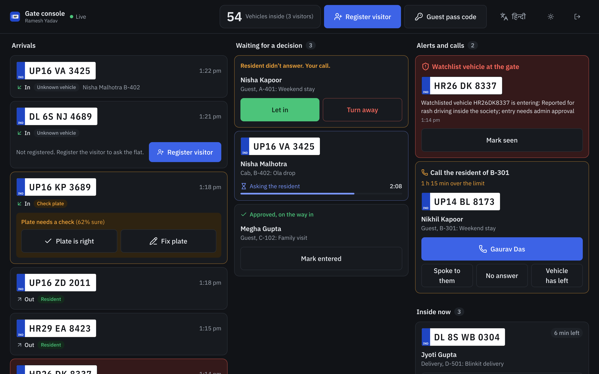
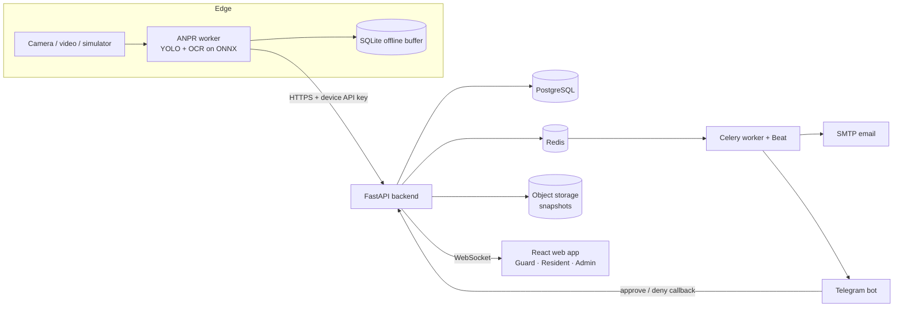
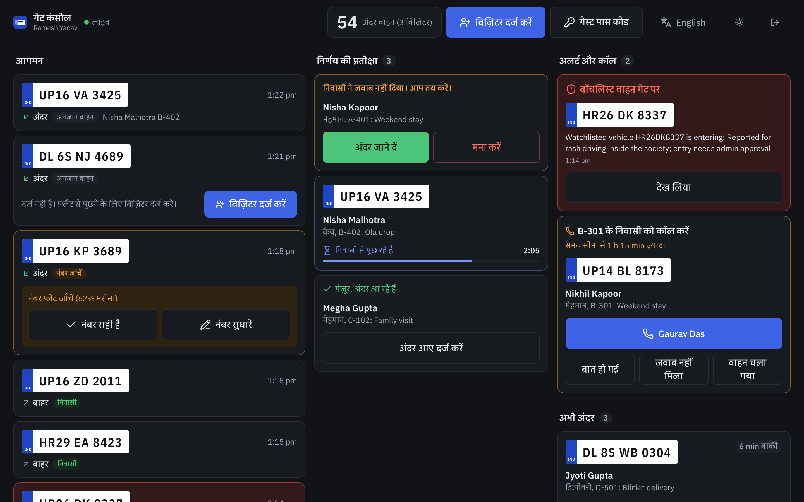
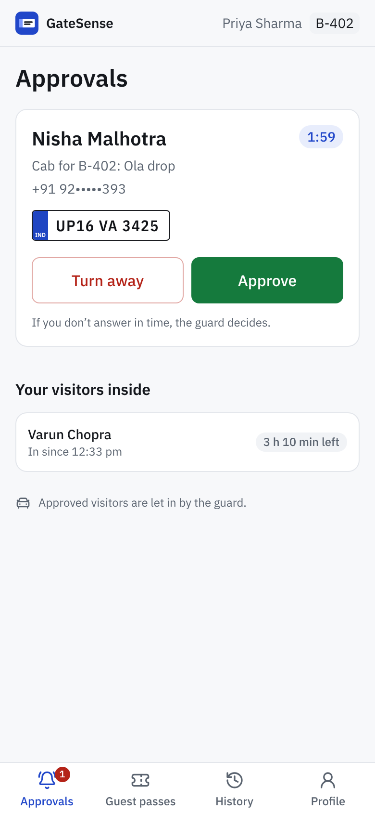
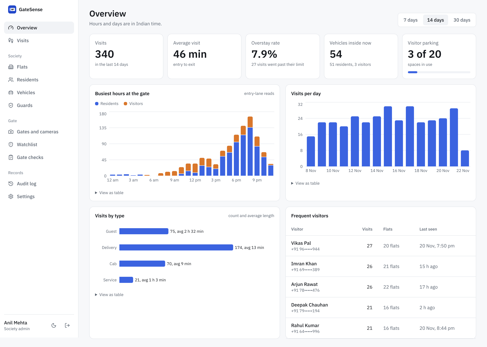

# GateSense

[](https://github.com/Akinchan-Jain-7/GateSense/actions/workflows/ci.yml)
[](#testing)
[](LICENSE)


<!-- Demo GIF goes here once recorded (docs/demo-script.md) -->



**GateSense is a gate and visitor system for housing societies.** A camera reads number
plates, so residents drive in without stopping. Visitors are approved by the resident
on their phone in real time. Vehicles that stay too long are followed up automatically.

## Try it

**Live demo:** not deployed yet. The hosting plan is ready ([docs/deployment.md](docs/deployment.md)).
Until then, the whole product runs locally with one command (see [Quick start](#quick-start)).
The login page has one-click buttons for each role:

| Role | What to try |
|---|---|
| **Guard** | Live feed of arrivals with plate snapshots, approve or deny a visitor in two taps, the Hindi toggle |
| **Resident** | Approve a visitor from the phone, create a guest pass, see the flat's visit history |
| **Admin** | Analytics, flats / residents / vehicles, watchlist, audit log, time limits and thresholds |

The vehicle simulator keeps the demo busy with realistic traffic: residents, unknown
visitors, guest passes, unclear plates, a watchlisted car, and overstays.

**With a real camera:** your laptop webcam can be the gate camera. Hold up a plate: a
resident's car is logged in, a new car goes to the guard to register. A live page shows
what the camera sees and what the server decided
([docs/webcam-demo.md](docs/webcam-demo.md), one command on Windows:
`.\scripts\webcam-demo.ps1`).

## What it does

- **Residents drive straight in.** The camera reads the plate, and a resident's car is
  logged in or out with no guard action.
- **Visitors are approved by the resident in real time.** The guard registers the
  visitor. The resident gets Approve / Deny on the web app and on Telegram. If there is no
  answer in 3 minutes, the guard decides.
- **Guest passes.** A resident can pre-approve a guest by plate or by a one-time code,
  for a time window and a number of uses.
- **Overstays are followed up.** Each visit type has a time limit (cab 10 min,
  delivery 20 min, guest 4 h). When it runs out, the visitor and the resident get an
  email. A reminder follows after 30 minutes. After 60 minutes the guard gets a
  "call the resident" task.
- **Unclear plates go to a person.** Low-confidence reads wait in a guard review queue.
  The guard's corrections are saved as labelled data for retraining.
- **Watchlist alerts.** A flagged plate raises a red alert on the guard console.
- **Works through internet cuts.** The camera worker buffers plate reads on disk and
  replays them in order when the connection is back. The server ignores duplicates.
- **Privacy built in.** Phone numbers are masked in lists, and visitor data is deleted
  after 90 days. Admin actions go to an audit log.

## Architecture



How the pieces work together, with the plate-read flow, the visit state machine and the
scheduled jobs: [docs/architecture.md](docs/architecture.md).

## Results

All numbers below were measured. Anything not measured yet says so.

| What | Result |
|---|---|
| Plate detector (YOLOv8n), tested on 354 photos from a **different** dataset (Gujarat) than it was trained on | mAP@0.5 **0.745**, mAP@0.5:0.95 0.384, recall 0.87, precision 0.67 (validation: 0.848 / 0.598). Trained on 453 openly licensed images. Beat YOLOv8s by the rule fixed in advance ([details](anpr/eval/results/detector_comparison.md)) |
| Plate detector speed on CPU (YOLOv8n, 1280×720 frame) | 65 ms FP32, 32 ms INT8 (static quantisation), on a 2-core machine ([details](anpr/eval/results/detector_latency.md)) |
| OCR and full plate accuracy per condition (day / night / rain / two-wheeler) | Not measured yet: needs labelled local photos ([notebook 02](anpr/notebooks/), [anpr/DATASET.md](anpr/DATASET.md)) |
| Gate-event ingestion, one API process, 40 simulated cameras | 159 req/s, p95 410 ms. The first bottleneck was found and fixed: +30% throughput with 80 vehicles, +58% with 500 ([method and numbers](docs/performance.md)) |
| Tests (coverage minimums enforced in CI) | Backend: 507 tests, 96% coverage. ANPR: 63 tests, 87%. Web: 53 tests, 81% of lines. Simulator: 16 tests. Plus 3 Playwright journeys and 42 automated WCAG 2.1 AA checks |

## Tech stack

| Layer | Tech |
|---|---|
| Backend | Python 3.12, FastAPI, Pydantic v2, SQLAlchemy 2 (async), Alembic, Celery + Beat |
| Data | PostgreSQL, Redis (cache, pub/sub, rate limits), S3-compatible object storage |
| Real time | WebSockets with Redis pub/sub fan-out, Telegram Bot API |
| ML | YOLOv8 (trained on Kaggle), EasyOCR / PaddleOCR, ONNX Runtime with INT8 quantisation |
| Frontend | React, TypeScript (strict), Vite, Tailwind CSS, shadcn/ui, TanStack Query, react-i18next, PWA |
| Testing | pytest, Vitest + Testing Library, Playwright, axe-core, Locust |
| Infra | Docker (multi-stage, non-root), Docker Compose, Caddy, GitHub Actions, GHCR (amd64 + arm64) |

## Quick start

You need [Docker](https://docs.docker.com/get-docker/) with Docker Compose.

```bash
git clone https://github.com/Akinchan-Jain-7/GateSense.git
cd GateSense
cp .env.example .env
docker compose up --build
# in a second terminal, load the demo data:
docker compose exec backend python -m app.seed
```

Open http://localhost:5173 and use the demo buttons, or sign in with password
`GateSense@123` as `admin@example.com`, `guard@example.com` or `resident@example.com`.

| Service | URL |
|---|---|
| Web app | http://localhost:5173 |
| API docs (OpenAPI) | http://localhost:8000/docs |
| Mailpit (catches every email) | http://localhost:8025 |
| Object storage console | http://localhost:9001 |

To make traffic, run the simulator ([simulator/README.md](simulator/README.md)). To work
on the code without Docker, see [CONTRIBUTING.md](CONTRIBUTING.md). To self-host the
production build, see [docs/deployment.md](docs/deployment.md).

## Screens

| Guard console (हिन्दी) | Resident app | Admin overview |
|---|---|---|
|  |  |  |

More in [docs/assets/](docs/assets/). Design decisions: [docs/design.md](docs/design.md).

## Project structure

```
backend/     FastAPI service: API, business logic (services/), Celery tasks
frontend/    React web app: Guard console, Resident PWA, Admin dashboard, landing page
anpr/        Number-plate recognition worker, training notebooks, evaluation scripts
simulator/   Demo traffic generator
loadtests/   Locust load tests
scripts/     Seed data, demo reset, helpers
docs/        Architecture, API, ADRs, deployment, study guides, progress tracker
```

## Design decisions

Each big decision has an Architecture Decision Record in [docs/adr/](docs/adr/):

- [0001 Monorepo and tech stack](docs/adr/0001-monorepo-and-tech-stack.md)
- [0002 Local S3-compatible storage](docs/adr/0002-dev-object-storage.md)
- [0003 Database layer and data model](docs/adr/0003-database-layer-and-data-model.md)
- [0004 Authentication and authorization](docs/adr/0004-authentication-and-authorization.md)
- [0005 Visit state machine](docs/adr/0005-visit-state-machine.md)
- [0006 Debounce and idempotency](docs/adr/0006-debounce-and-idempotency.md)
- [0007 Snapshot storage and Phase 2 model changes](docs/adr/0007-snapshot-storage-and-phase-2-model-changes.md)
- [0008 Plate repair and fuzzy matching](docs/adr/0008-plate-repair-and-fuzzy-matching.md)
- [0009 ANPR pipeline and model choice](docs/adr/0009-anpr-pipeline-and-model-choice.md)
- [0010 Approvals, real time and background jobs](docs/adr/0010-approvals-real-time-and-background-jobs.md)
- [0011 Escalation, notifications and scheduled jobs](docs/adr/0011-escalation-notifications-and-scheduled-jobs.md)
- [0012 Frontend architecture and design system](docs/adr/0012-frontend-architecture.md)
- [0013 Hardening, offline mode and observability](docs/adr/0013-hardening-and-observability.md)
- [0014 Deployment architecture](docs/adr/0014-deployment-architecture.md) (proposed)
- [0015 Laptop webcam demo](docs/adr/0015-laptop-webcam-demo.md)

## Testing

- **Backend:** `cd backend && uv run pytest --cov`. Tests run against a real Postgres,
  each in its own rolled-back transaction. They cover every role on every route, the
  migrations, the plate normaliser (table-driven), the visit state machine, and
  time-mocked escalation runs.
- **ANPR:** `cd anpr && uv run pytest --cov`: detector, frame tracker, offline buffer and
  ordered replay, the pipeline on video files and image folders, and the live preview
  (threads, the local page and its security checks).
- **Frontend:** `cd frontend && npm test` (Vitest + Testing Library), and `npm run e2e`
  (Playwright journeys and accessibility checks) against the running stack.
- **CI** runs all of the above with Postgres and Redis service containers, Playwright
  against the real API, a `docker compose up` smoke test of both the dev and production
  stacks, and a secret scan (gitleaks).

## Known limitations

- **No live deployment yet.** The images build and publish on every green `main`, and the
  deploy step waits for a server ([docs/deployment.md](docs/deployment.md)).
- **OCR accuracy isn't measured yet.** The comparison notebook is ready but needs labelled
  photos of real local plates (day, night, rain, two-wheelers).
- **The detector was trained on a small dataset** (453 images). It reaches 0.745 mAP@0.5
  on photos from another state, which is usable but leaves room to improve. Guard
  corrections are stored so the model can be retrained on real gate data.
- **Telegram is tested against a fake bot.** The full flow has tests, but it hasn't been
  run against the real Telegram API with a live token.
- **Load numbers come from a 2-core machine.** A second API worker gave no gain there
  because the CPU was already full ([docs/performance.md](docs/performance.md)).
- **One society per install.** Every table has a `society_id`, but there is no
  multi-tenant UI or isolation yet.

## Future work

- Multi-society tenancy (the schema already has `society_id`)
- Paid SMS and voice-call providers for escalations
- Native mobile apps
- Tailgating detection (two cars on one barrier opening)
- A plate-specific OCR model trained on the guard corrections

## License

[MIT](LICENSE)
