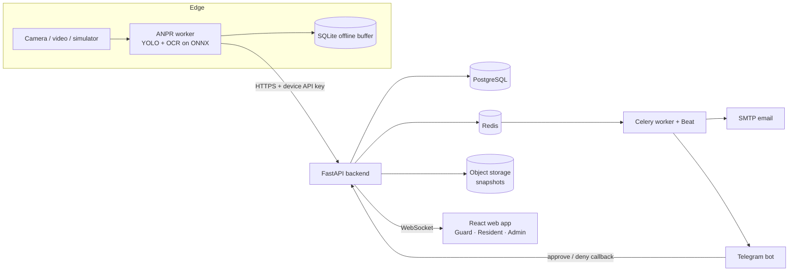

# GateSense

**AI-powered society gate and visitor management.** Automatic number-plate entry for
residents, resident-approved visitors, and an escalation engine that follows up on
overstaying vehicles.

[](https://github.com/Akinchan-Jain-7/GateSense/actions/workflows/ci.yml)

[](LICENSE)


> 🚧 **Status:** under active development, built in phases.
> See [docs/PROGRESS.md](docs/PROGRESS.md) for where things stand.

<!-- Demo GIF goes here (Phase 9) -->

## Live demo

TBD (deployed in Phase 8). One-click demo logins for Guard, Resident and Admin.

## Features

- **Automatic entry and exit** for residents' vehicles via number-plate recognition
- **Visitor approvals** in real time on the web and Telegram, with a 3-minute guard fallback
- **Guest passes** that residents create ahead of time
- **Escalation ladder** for overstaying vehicles: emails, then a call task for the guard
- **Watchlist alerts**, a low-confidence review queue, analytics, and privacy controls

Full scope: [CLAUDE.md §2](CLAUDE.md#2-feature-scope).

## Architecture



More detail: [docs/architecture.md](docs/architecture.md).

## Results

Real measured numbers only. Each one is filled in by the phase that measures it.

| Metric | Value |
|---|---|
| Plate detection mAP@0.5 | TBD (measured in Phase 3) |
| End-to-end plate accuracy | TBD (measured in Phase 3) |
| ANPR latency on CPU | TBD (measured in Phase 3) |
| Gate-event ingestion throughput / p95 | TBD (measured in Phase 7) |
| Test coverage | TBD (measured in Phase 7) |

## Tech stack

| Layer | Tech |
|---|---|
| Backend | Python 3.12, FastAPI, Pydantic v2, SQLAlchemy 2.0, Alembic, Celery |
| Data | PostgreSQL, Redis, S3-compatible object storage |
| ML | YOLOv8, PaddleOCR / EasyOCR, ONNX Runtime |
| Frontend | React, TypeScript, Vite, Tailwind CSS, shadcn/ui, TanStack Query |
| Infra | Docker, Docker Compose, GitHub Actions, GHCR |

## Quick start

You need [Docker](https://docs.docker.com/get-docker/) with Docker Compose.

```bash
git clone https://github.com/Akinchan-Jain-7/GateSense.git
cd GateSense
cp .env.example .env
docker compose up --build
```

| Service | URL |
|---|---|
| Frontend | http://localhost:5173 |
| Backend API docs | http://localhost:8000/docs |
| Mailpit (dev inbox) | http://localhost:8025 |
| Object storage console | http://localhost:9001 |

For working on the code without Docker, see [CONTRIBUTING.md](CONTRIBUTING.md).

## Project structure

```
backend/     FastAPI service (API, business logic, Celery tasks)
frontend/    React web app (Guard console, Resident PWA, Admin dashboard)
anpr/        Number-plate recognition worker + training notebooks
simulator/   Demo traffic generator
loadtests/   Locust load tests
scripts/     Seed data, demo reset, helpers
docs/        Architecture, ADRs, study guides, progress tracker
```

## Design decisions

Architecture Decision Records live in [docs/adr/](docs/adr/):

- [ADR-0001: Monorepo and tech stack](docs/adr/0001-monorepo-and-tech-stack.md)
- [ADR-0002: Local S3-compatible storage](docs/adr/0002-dev-object-storage.md)

## Testing

TBD (expanded as each phase adds tests). Today: `uv run pytest` in `backend/`,
`npm test` in `frontend/`, and CI runs both plus a full `docker compose up` smoke test.

## Known limitations

TBD (Phase 9).

## Future work

- Multi-society tenancy (the schema keeps a `society_id` column so this stays possible)
- Paid SMS and voice-call providers
- Native mobile apps
- Tailgating detection

## License

[MIT](LICENSE)
