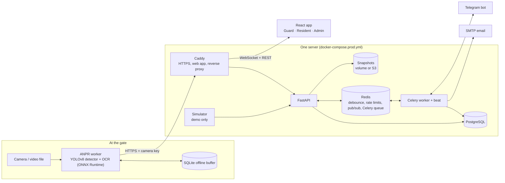
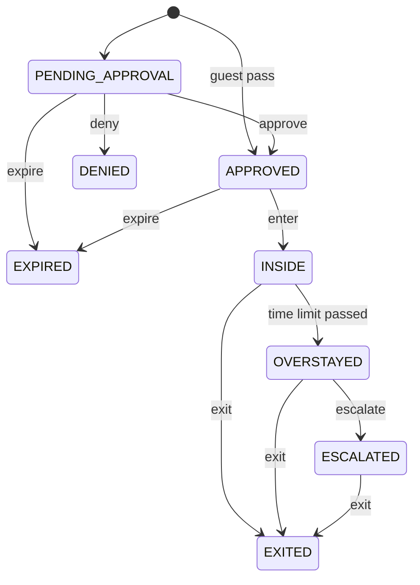

# Architecture

GateSense is one backend (FastAPI + PostgreSQL + Redis + Celery), one web app (React), and
an ANPR worker that runs next to the cameras. This page is the map: what each part does,
how a plate read becomes a visit, and where the important rules live. Each decision has an
ADR in [adr/](adr/).

## The parts

| Part          | Code                     | What it does                                                                                                                                                   |
| ------------- | ------------------------ | -------------------------------------------------------------------------------------------------------------------------------------------------------------- |
| ANPR worker   | `anpr/gatesense_anpr/`   | Reads frames, finds plates (YOLOv8 → ONNX), reads text (OCR), votes across frames, posts one read per car; buffers in SQLite when offline (ADR-0009, ADR-0013) |
| API           | `backend/app/api/v1/`    | HTTP routes only: parse, check permissions, call a service, return a schema                                                                                    |
| Services      | `backend/app/services/`  | All business rules, plain async functions that take a DB session (tested without HTTP)                                                                         |
| Models        | `backend/app/models/`    | SQLAlchemy tables; schema changes go through Alembic migrations ([database.md](database.md))                                                                   |
| Worker + beat | `backend/app/workers/`   | Scheduled and background jobs (below)                                                                                                                          |
| Web app       | `frontend/src/features/` | Guard console, resident PWA, admin dashboard, landing page ([design.md](design.md))                                                                            |
| Simulator     | `simulator/`             | Demo traffic through the public API                                                                                                                            |
| Caddy         | `frontend/Caddyfile`     | The only public entry point in production ([deployment.md](deployment.md))                                                                                     |

## From a plate read to a visit

1. **The camera posts a read** (`POST /api/v1/gate-events`, multipart: plate text,
   confidence, lane, capture time, snapshot). The camera key is hashed and checked; each key
   has a rate limit.
2. **Duplicates are dropped.** The same plate in front of the same lane within a cooldown
   window is one event (Redis `SET NX` with expiry), and an exact repeat (same device,
   plate, capture time) is rejected by a unique `event_hash`, so a camera can safely resend
   (ADR-0006).
3. **The plate is repaired and matched.** OCR confusions are fixed by position (letters vs
   digits: `O/0`, `I/1`, `B/8`, `S/5`, `Z/2`), the Indian formats are checked (state
   series, BH series), then the plate is matched against residents' vehicles, valid guest
   passes and the watchlist, allowing a small edit distance (ADR-0008).
4. **What happens next depends on the match:**
   - resident vehicle → entry/exit logged (entry and exit paired, `SELECT … FOR UPDATE`)
   - guest pass → visit created already approved; the guard sees "expected"
   - visitor already approved → visit moves to _inside_, its timer starts
   - watchlist → high-priority alert on the guard console
   - low confidence → review queue; the guard's correction is kept as labelled data
   - unknown → shown to the guard, who registers the visitor
5. **Registering a visitor** asks the flat's residents: a WebSocket push to the resident app
   and a Telegram message with Approve / Deny buttons. If nobody answers in 3 minutes (a
   Celery task scheduled at creation), the guard decides (ADR-0010).
6. **The exit camera** closes the visit.

## The visit state machine

Every status change goes through one function (`services/visit_state.py`) that checks a
table of allowed transitions and writes a history row; anything else is a 409 (ADR-0005).

## Background jobs (Celery)

| Job                      | When                  | What                                                                                                                                                                              |
| ------------------------ | --------------------- | --------------------------------------------------------------------------------------------------------------------------------------------------------------------------------- |
| `approvals.expire`       | 3 min after a request | Hands an unanswered approval to the guard                                                                                                                                         |
| `approvals.telegram`     | on each request       | Queues and sends the Telegram message (retried by the dispatcher)                                                                                                                 |
| `escalation.tick`        | every minute          | Overstay ladder: email at the limit, a reminder 30 min later, a "call the resident" task for the guard at 60 min. Each step has an idempotency key, so it happens once (ADR-0011) |
| `notifications.dispatch` | every minute          | Sends queued email and Telegram messages; retries with backoff (1, 2, 4… min, capped at 1 h); cancels approval messages already answered                                          |
| `reconciliation.nightly` | 03:00 IST             | Finds exits without entries and entries never closed; flags them for the admin                                                                                                    |
| `retention.daily`        | 03:30 IST             | Deletes visitor personal data older than the retention period (90 days)                                                                                                           |
| `demo.nightly_reset`     | 04:00 IST             | Reseeds the public demo (only when `DEMO_MODE=true`)                                                                                                                              |

## Real time

The API publishes small events (`gate_event.created`, `approval.requested`, …) to Redis
channels: one per society for the guard console, one per user for residents. Each
WebSocket connection (`/api/v1/ws`, token checked on connect) subscribes to its channels
and forwards events. The web app keeps one socket per tab, reconnects with exponential
backoff and jitter, and turns each event into "refetch this list" (TanStack Query), so the
server never has to know what a screen shows. Redis pub/sub means it works with several API
processes.

## Security, privacy and operations

- **Auth:** short-lived JWT access tokens + rotating refresh tokens, Argon2 password
  hashes, role checks as FastAPI dependencies (admin, guard, resident); cameras use hashed
  API keys (ADR-0004).
- **Limits:** login rate limits per IP and per account, per-camera rate limit, request body
  size limits, security headers, a strict CSP, CORS locked to the app (ADR-0013).
- **Privacy:** phone numbers masked in lists; visitor data deleted after the retention
  period; every admin change is in the audit log; the visitor's "time left" page is a
  signed, expiring link.
- **Observability:** a request id on every log line (JSON logs), Prometheus `/metrics`,
  `/health` and `/ready` (database and Redis).
- **Deployment:** one server with Docker Compose, Caddy in front, images built by CI for
  amd64 and arm64 ([deployment.md](deployment.md), ADR-0014).

## Where the numbers come from

Load test and the bottleneck it found: [performance.md](performance.md). Detector and OCR
results: `anpr/eval/results/`. Every number in the docs comes from a run that was actually
done; anything not measured yet is marked TBD.
