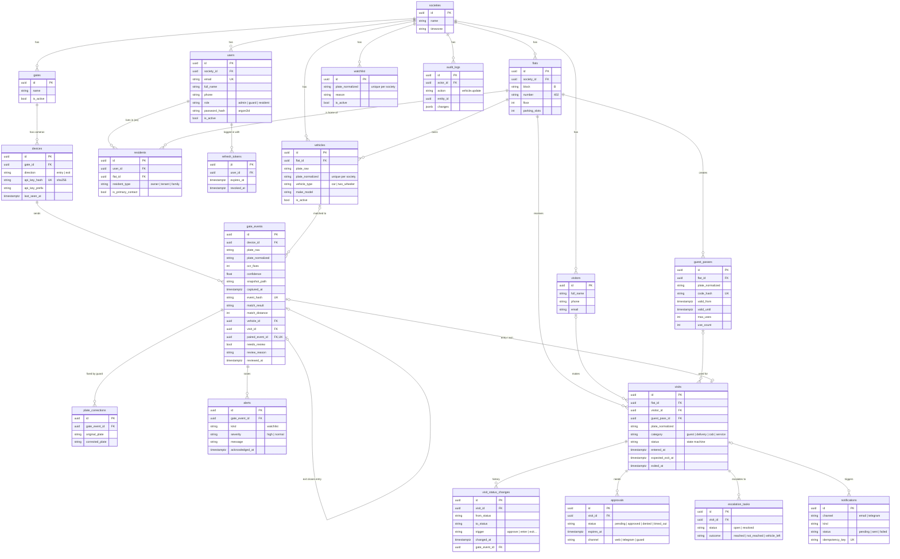

# Database

PostgreSQL, accessed through SQLAlchemy 2.x (async, psycopg 3 driver). The schema is
created and changed only by **Alembic migrations** in `backend/alembic/versions/`.
Decisions behind the design: [ADR-0003](adr/0003-database-layer-and-data-model.md).

```bash
cd backend
uv run alembic upgrade head                           # create / update the schema
uv run alembic revision --autogenerate -m "add X"     # new migration after a model change
uv run alembic check                                  # fails if models and migrations differ
uv run python -m app.seed                             # demo data (see "Seed data" below)
```

## Conventions

| Convention | Why |
|---|---|
| `id` is a random **UUID** | Safe in URLs: ids can't be guessed or counted (`/flats/1`, `/flats/2`…). |
| `created_at` / `updated_at` (`timestamptz`) on most tables | Set by the database; always stored in UTC. |
| `society_id` on top-level tables | v1 runs one society, but multi-society tenancy stays possible. Every query filters by the caller's society. |
| Enums stored as `VARCHAR` + `CHECK` constraint | Adding a value later is a simple constraint change, not an `ALTER TYPE`. |
| Named constraints (`uq_…`, `fk_…`, `ck_…`, `ix_…`) | Migrations can drop or change a constraint by a predictable name. |
| Plates stored twice: `plate_raw` + `plate_normalized` | Keep what was typed or read; match on the clean form (`DL01AB1234`). |
| People are **deactivated**, not deleted | Past approvals and corrections stay attributed to someone. |

## ER diagram



## Tables

Phase 1 created every table of the brief's data model, so the whole model could be
reviewed at once. Phase 2 added `alerts`, `visit_status_changes` and some `gate_events`
columns (see [ADR-0007](adr/0007-snapshot-storage-and-phase-2-model-changes.md)). Tables
marked *(Phase N)* have no API yet.

**People and places**

- **`societies`**: the housing society. One row in v1.
- **`flats`**: one per apartment. `block` + `number` are unique per society and shown as
  the label `B-402`. `parking_slots` feeds parking-occupancy analytics later.
- **`users`**: everyone who logs in. `role` decides what they may do (admin, guard,
  resident). Emails are stored lower-case and are unique across the system (login is by
  email). Passwords are stored only as Argon2id hashes.
- **`residents`**: links a resident user to a flat (a person can be linked to more than one).
  `is_primary_contact` marks who is asked first to approve visitors; at most one per flat.
- **`refresh_tokens`**: one row per issued refresh token, keyed by the token's `jti`. Lets
  us make each refresh token single-use and revoke sessions on logout or deactivation.

**Vehicles and gates**

- **`vehicles`**: resident vehicles, owned by a flat. `plate_normalized` is unique per
  society and indexed: it's what the gate engine looks up on every camera read.
- **`watchlist`**: flagged plates (unique per society). A read within one edit of a flagged
  plate raises a high-priority alert.
- **`gates`**: physical gates ("Main Gate", "Service Gate").
- **`devices`**: one camera per lane (`entry` or `exit`) of a gate. Authenticates with an
  API key; only its SHA-256 hash is stored, plus a short prefix to tell keys apart.
- **`gate_events`**: every plate read a device sends: raw OCR text, the repaired plate and
  how many look-alike characters were fixed (`ocr_fixes`), confidence, snapshot, what it
  matched and how closely (`match_distance` 0 = exact, 1 = one character off).
  `event_hash` is unique, so a retried upload of the same read is stored once.
  On a resident **exit**, `paired_event_id` points at the **entry** it closes (unique: an
  entry is closed once). `needs_review` + `review_reason` put an event in the guard's
  review queue until `reviewed_at` is set. A partial index serves exactly that queue.
- **`plate_corrections`**: a guard's confirmation or fix of a review item, next to what OCR
  read: labelled data for retraining the OCR model (Phase 3).
- **`alerts`**: things the guard must see now (watchlist hits). Open until a guard
  acknowledges them.

**Visits** *(Phases 2, 4, 5)*

- **`visitors`**: name, phone, email of people who visit. Purged after the retention
  period *(Phase 5)*.
- **`visits`**: one visit to one flat, moved through the state machine
  `pending_approval → approved → inside → overstayed → escalated → exited` (+ `denied`,
  `expired`). Links to the entry and exit gate events. Only `services/visits.py` changes
  `status`, using the rules in `services/visit_state.py`.
- **`visit_status_changes`**: the history of every visit, one row per status change (from,
  to, trigger, when, and the user or gate event that caused it). Written in the same
  transaction as the change; never updated.
- **`approvals`**: a request to the flat to approve or deny a visit, with a 3-minute expiry.
- **`guest_passes`**: created by residents ahead of time, matched by plate or by a one-time
  code (only its hash is stored). Two `CHECK` constraints: a pass needs a plate or a code,
  and `use_count` can never exceed `max_uses`.
- **`escalation_tasks`**: "call the resident" jobs for guards when a visit overstays.

**Operations**

- **`notifications`** *(Phase 5)*: log of every email / Telegram message. The unique
  `idempotency_key` guarantees a retried job never sends the same message twice.
- **`audit_logs`**: one row per admin create / update / delete: who, what, and the changed
  fields as JSON (`{"colour": ["White", "Grey"]}`). Passwords never appear in it.

## Delete rules

| Record | `DELETE` does | Why |
|---|---|---|
| Guard, resident | Deactivates the login (resident: removes the flat link first) | History must keep pointing at a real person. |
| Flat, gate, device | Deletes only if nothing references it, otherwise **409** | A device that sent events, or a flat with residents, has history; deactivate instead. |
| Vehicle, watchlist entry | Deletes | Gate events keep the plate text; their `vehicle_id` becomes `NULL`. |

The "only if nothing references it" rule is enforced by the database's foreign keys; the
API turns the constraint error into a clear 409 message.

## Seed data

`uv run python -m app.seed` fills an empty database with fictional but realistic data
(fixed random seed, so every run is identical):

- Society "Aravali Heights", Sector 150, Noida; 40 flats (blocks A–D, floors 1–5)
- 60 residents with Indian names; 80 vehicles with valid plates (UP16, UP14, DL, HR, BH series…)
- 1 admin, 3 guards, 2 gates with an entry and an exit camera each, 3 watchlist entries
- Demo logins (password `GateSense@123`, from `DEMO_PASSWORD`):
  `admin@example.com`, `guard@example.com`, `resident@example.com` (Priya Sharma, B-402)

The script prints each camera's API key once. `--reset` empties every table first.
