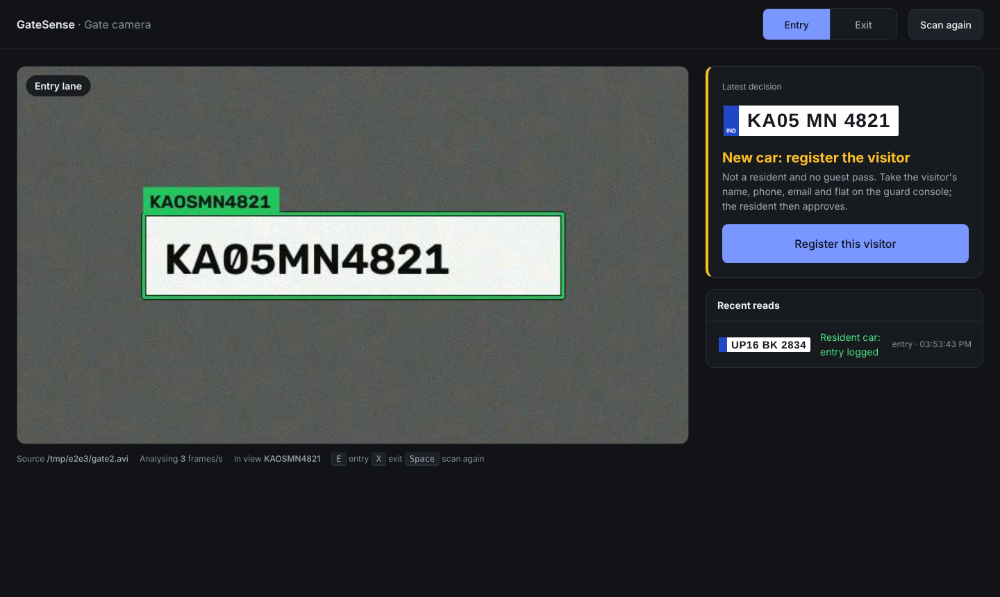
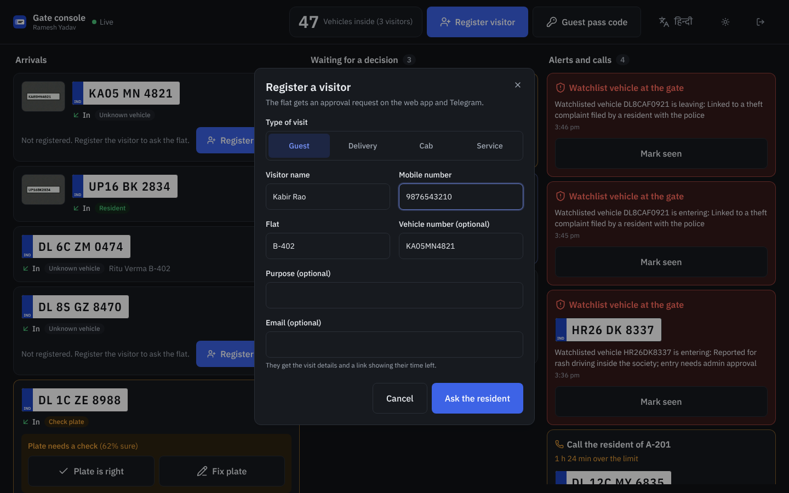

# Laptop webcam demo

Use your laptop's webcam as the gate camera: hold a number plate up to it, and GateSense
reads it. A resident's car gets its entry logged automatically. A new car shows up on the
guard console, where the guard takes the visitor's name, phone, email and flat, and the
resident approves.

This is for showing GateSense on your own machine (an evaluation, an interview). The
camera program is the same one that runs at a real gate (`anpr/`), with one extra: a live
preview page.

```
 laptop webcam ──► camera program (anpr/) ──► API (backend/) ──► guard console (browser)
                    │ YOLO finds the plate        │ repairs the text        │ live arrivals,
                    │ EasyOCR reads it            │ resident? visitor?      │ Register visitor
                    │ votes over a few frames     │ watchlist? unknown?     │
                    ▼                             ▼
             preview page                 the decision comes back
         http://127.0.0.1:8765            and is shown on the preview page
```

## What the screen looks like

Two browser windows side by side:

- **Preview page** (left), `http://127.0.0.1:8765`: the camera picture with a box around
  the plate, the text the camera read, and the server's decision, colour-coded with a word:
  *Resident car: entry logged* (green), *New car: register the visitor* (amber),
  *Watchlist plate* (red). Buttons: **Entry / Exit** (which lane the camera watches) and
  **Scan again**. Keys: `E`, `X`, `Space`.
- **Guard console** (right), `http://localhost:5173/guard`: the arrival appears live with
  its snapshot. For a new car, **Register this visitor** on the preview page opens the
  form here with the plate filled in and the car's read linked to the visit.



*Above: a rehearsal with a recorded test video. Below: "Register this visitor" opened the
guard console's form with the plate filled in.*



## One-time setup

1. The normal local setup from [CONTRIBUTING.md](../CONTRIBUTING.md): Docker Desktop,
   uv, Node.js 22, `uv sync` in `backend/`, `npm ci` in `frontend/`, the database migrated
   and seeded (`uv run alembic upgrade head`, `uv run python -m app.seed`).
2. **The plate detector model**, `plate_detector.onnx`. The launcher finds it by itself
   if it is in your **Downloads** folder (from the Kaggle run) or published as the
   `models-v1` release. It checks the file's SHA-256 either way.
3. Nothing else. The launcher installs EasyOCR the first time (about 1 GB, mostly
   PyTorch; it takes a few minutes).

## Run it (Windows)

Start the services, each in its own terminal (leave them running):

```powershell
docker compose up postgres redis mailpit storage
cd backend; uv run uvicorn app.main:app --reload
cd backend; uv run celery -A app.workers.celery_app worker --pool=solo --loglevel=info
cd frontend; npm run dev
```

The Celery worker runs the resident's 3-minute approval timeout and sends the emails.
Then, in a fourth terminal, from the repo folder:

```powershell
.\scripts\webcam-demo.ps1
```

If Windows says running scripts is disabled, allow it for this one terminal first:
`Set-ExecutionPolicy -Scope Process Bypass`.

The launcher:

1. checks the API is up;
2. puts the model in `anpr/models/` (from Downloads or the release, hash-checked);
3. installs the camera program's packages (`uv sync --extra easyocr`);
4. runs `python -m app.webcam_devices`: two cameras on the Main Gate, **Laptop webcam -
   entry** and **Laptop webcam - exit**, with fresh keys written to `anpr/.env`. It also
   writes `anpr/data/demo-plates.html` and prints which plates to try;
5. opens the guard console's sign-in page (use the guard demo login);
6. starts the camera with the preview page. **Ctrl+C** stops it.

Options: `-Camera 1` for a second (USB) camera, `-Camera path\to\video.mp4` to rehearse
with a recording, `-NoBrowser` to open nothing.

### By hand (any OS)

```bash
cd backend && uv run python -m app.webcam_devices      # keys -> anpr/.env, demo plates page
cd ../anpr && uv sync --extra easyocr
uv run python -m gatesense_anpr.download_model          # or copy plate_detector.onnx to anpr/models/
uv run gatesense-anpr --source 0 --preview
```

## A two-minute demo

`webcam_devices` prints the plates to use and puts them on a page you can open on your
phone (`anpr/data/demo-plates.html`; copy it to the phone or print it, one plate per page).

1. **Resident drives in.** Show a resident's plate (the first one listed belongs to flat
   B-402). Preview: green *Resident car: entry logged*. Console: the arrival appears; the
   *inside now* count goes up. Nobody had to do anything.
2. **A visitor arrives.** Show the "car nobody knows" plate. Preview: amber
   *New car: register the visitor*. Click **Register this visitor**. On the console, fill
   in a name, mobile number, email and flat **B-402**, then **Ask the resident**.
3. **The resident approves.** In a private window, sign in as the resident
   (`resident@example.com`) and approve. The visitor is let in and the visit timer starts.
   With a Telegram bot linked, the approval also arrives on Telegram.
4. **Leaving.** Press **X** (exit lane) and show the resident's plate again: *Resident
   car: exit logged*; the open entry is closed.
5. **Watchlist.** Show the watchlist plate: red *Watchlist plate*, and a red alert pops up
   on the guard console.

Talking points: the camera program is the "edge" part of the system and works through
internet cuts (stop the API for a moment: reads are saved and sent when it's back). The
server, not the camera, repairs OCR mistakes (`KAOSMN4821` → `KA05MN4821`) and decides
what a plate means. One car in front of the camera is one event (debounce), however long
it stays.

## Tips for a smooth demo

- **Hold the plate steady for about a second**, filling roughly a third of the picture.
  The camera sends once three readings agree.
- **The detector was trained on photos of cars**, not of plates on their own. A photo of a
  car's front (your own, or one from the web) on your phone works best; a printed plate
  usually works too. Turn the phone brightness up and avoid reflections.
- **The same plate twice within 30 seconds on one lane is one car** (debounce). The
  preview says *Same car, seen a moment ago*. Wait 30 seconds, switch lanes, or show
  another plate.
- **Run `webcam_devices` again after a demo data reset** (`python -m app.seed --reset`, the
  admin's *Reset demo*, or the nightly reset when Celery Beat runs with `DEMO_MODE=true`).
  Resets replace every camera, so the old keys stop working. The preview says so: *The
  server doesn't know this camera*. The launcher does this for you on every start.

- **Want a busy console behind your webcam demo?** Run the traffic simulator too
  (`cd simulator; uv run gatesense-sim --speed 5`). It leaves the laptop webcam's cameras
  alone, so both run side by side.

## Measure the real reading accuracy

The camera page has a **Save for testing** panel. Hold up a plate, check the plate number
in the box (it follows the latest read; type over it if the read was wrong), pick what the
camera sees (a phone screen, a printout, a real car...), and press **Save photo**. Each
save stores the picture and the right answer in `anpr/data/eval/webcam/` (git ignores it:
plates are personal data).

After 30 or more, measure the whole chain (detector + OCR) on them:

```powershell
cd anpr
uv run python eval/evaluate_pipeline.py data/eval/webcam --name e2e_webcam
```

The table lands in `anpr/eval/results/e2e_webcam.md`, per condition. These are real
numbers for the README; share the table (not the photos) and they go in.

## Troubleshooting

| What you see | What to do |
|---|---|
| *Waiting for the camera...* / *another app using the camera* | Close Zoom, Teams or the Camera app; only one program can use a webcam at a time. Or try `-Camera 1`. |
| No box around the plate | Bring it closer, more light, less tilt. Check the terminal for errors. |
| A box, but *reading...* | OCR can't read it: sharper picture, plate straight on, no glare. |
| *Not sure of the plate* | The read was below the confidence threshold; it waits in the guard's review queue (fix it there). |
| *Server not reachable* | The API is down. Reads are kept and sent when it's back. |
| *The server doesn't know this camera* | Run `cd backend; uv run python -m app.webcam_devices`, then restart the camera. |
| Exit button greyed out | `ANPR_EXIT_DEVICE_KEY` is missing from `anpr/.env`; run `webcam_devices`. |
| Port 8765 is in use | Set `ANPR_PREVIEW_PORT=8766` in `anpr/.env`. |

## How it works

- `anpr/gatesense_anpr/live.py`: three threads share one state object. The **camera
  thread** reads frames as fast as the webcam gives them and keeps only the newest. The
  **analysis thread** runs the normal pipeline (detect → OCR → track → send) on the newest
  frame about 5 times a second. The **web server** serves the page, an MJPEG video stream
  with the boxes drawn in, and the state as JSON. Button presses are handed to the
  analysis thread as requests, so only one thread ever touches the pipeline.
- **One webcam, two lanes.** The server knows a lane by its device, so the webcam is two
  devices with two keys. Each lane also has its own offline buffer, so a read saved while
  the API was down is replayed on the lane it was seen on.
- **The preview page is local only.** It listens on `127.0.0.1`, refuses requests for any
  other host name (DNS rebinding), and its buttons need a custom header that another
  website's page can't send.
- **New-car link.** *Register this visitor* opens
  `/guard?register=<plate>&event=<gate event id>`; the console opens the form with both
  filled in, then removes them from the address so a refresh doesn't reopen it.
- Decision record: [ADR-0015](adr/0015-laptop-webcam-demo.md). Study notes:
  [docs/learn/webcam-demo.md](learn/webcam-demo.md).
